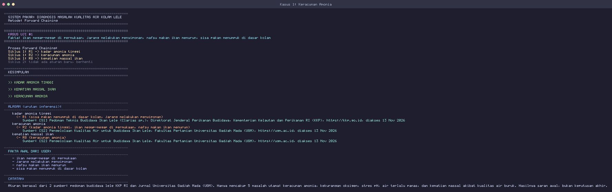
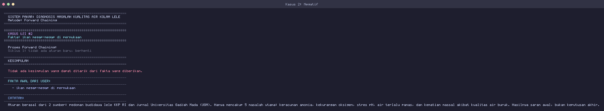
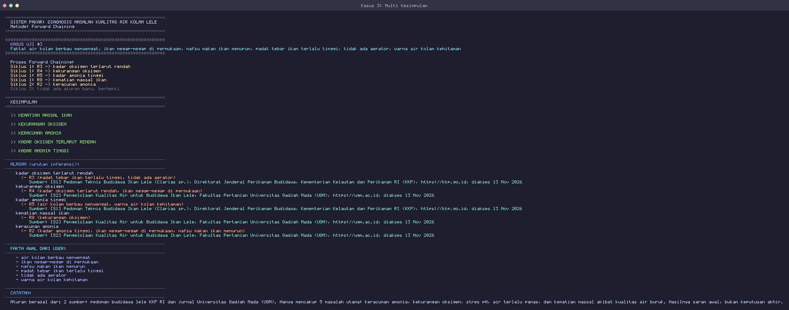

# Sistem Pakar: Diagnosis Masalah Kualitas Air Kolam Lele

> **Nama:** WIMAR ARYASMARTA PRAKASA  
> **NIM:** F1D02410026  

---

## 1. Topik

**Diagnosis Masalah Kualitas Air Kolam Lele** — Sistem pakar berbasis aturan (rule-based expert system) untuk membantu pembudidaya ikan lele (*Clarias sp.*) mendiagnosis masalah kualitas air kolam berdasarkan gejala yang teramati.

---

## 2. Cara Menjalankan Program

| Item | Keterangan |
|------|------------|
| Bahasa | Python |
| Versi | Python 3.6 atau lebih baru |
| Library | Tidak memerlukan library tambahan (hanya `json`, `sys`, `os` dari standard library) |

### Perintah

```bash
# Mode interaktif (jawab pertanyaan y/t)
python forward_chaining.py

# Jalankan kasus uji tertentu (1-4)
python forward_chaining.py --test 1
python forward_chaining.py --test 2
python forward_chaining.py --test 3
```

Pilih mode **1** untuk interaktif atau **2** untuk uji otomatis semua kasus.

---

## 3. Daftar Sumber

| ID | Judul | Penerbit | URL | Tanggal Akses |
|----|-------|----------|-----|---------------|
| S1 | Pedoman Teknis Budidaya Ikan Lele (*Clarias sp.*) | Direktorat Jenderal Perikanan Budidaya, Kementerian Kelautan dan Perikanan RI (KKP) | https://kkp.go.id | 13 November 2026 |
| S2 | Pengelolaan Kualitas Air untuk Budidaya Ikan Lele | Fakultas Pertanian, Universitas Gadjah Mada (UGM) | https://ugm.ac.id | 13 November 2026 |

### Rangkuman Parameter Kualitas Air (dari sumber)

| Parameter | Nilai Ideal | Dampak Jika Tidak Ideal |
|-----------|-------------|-------------------------|
| pH | 6,5 – 8,5 | Stres, rentan penyakit |
| Oksigen Terlarut (DO) | > 3–5 mg/L | Ikan megap-megap, kematian massal |
| Amonia (NH₃) | < 0,1 ppm | Kerusakan insang, nafsu makan turun |
| Suhu | 26–30°C | Metabolisme terganggu |

---

## 4. Tabel Aturan IF-THEN

Knowledge base disimpan di file [`kb_lele.json`](kb_lele.json). Total: **8 aturan** dengan **6 kesimpulan** berbeda.

| Aturan | IF (Syarat) | Mode | THEN (Kesimpulan) | Sumber |
|--------|-------------|------|-------------------|--------|
| R1 | sisa pakan menumpuk di dasar kolam **DAN** jarang melakukan penyiponan | dan | kadar amonia tinggi | S1 |
| R2 | kadar amonia tinggi **DAN** ikan megap-megap di permukaan **DAN** nafsu makan ikan menurun | dan | keracunan amonia | S2 |
| R3 | padat tebar ikan terlalu tinggi **DAN** tidak ada aerator | dan | kadar oksigen terlarut rendah | S1 |
| R4 | kadar oksigen terlarut rendah **DAN** ikan megap-megap di permukaan | dan | kekurangan oksigen | S2 |
| R5 | air kolam berbau menyengat **DAN** warna air kolam kehitaman | dan | kadar amonia tinggi | S1 |
| R6 | pH air di bawah 6 **DAN** ikan sering melompat | dan | stres pH asam | S2 |
| R7 | suhu air di atas 32 derajat **DAN** ikan berkumpul di dasar kolam | dan | air terlalu panas | S1 |
| R8 | keracunan amonia **ATAU** kekurangan oksigen | atau | kematian massal ikan | S2 |

### Rantai Aturan (aturan memakai hasil aturan lain)

```
R1 (sisa pakan + jarang sipon) ──→ "kadar amonia tinggi"
                                        │
R5 (bau menyengat + kehitaman) ────────┘
                                        ▼
                                R2 (+ megap-megap + nafsu makan turun) ──→ "keracunan amonia" ──┐
                                                                                                │
R3 (padat tebar + tanpa aerator) ──→ "kadar oksigen rendah"                                    │
                                        │                                                      ▼
                                        ▼                                               R8 ──→ "kematian
                                R4 (+ megap-megap) ──→ "kekurangan oksigen" ──────────────┘     massal ikan"
```

---

## 5. Metode: Forward Chaining

### Alasan Pemilihan

Forward Chaining (FC) dipilih karena sesuai dengan skenario diagnosis: pembudidaya mengamati **gejala-gejala** pada kolam (fakta), lalu sistem menarik kesimpulan secara otomatis dari gejala tersebut. FC bekerja data-driven, dari fakta menuju kesimpulan, cocok ketika:

- Semua fakta bisa dikumpulkan di awal (melalui observasi kolam).
- Sistem perlu menemukan **semua kemungkinan** masalah, bukan hanya satu.
- Ada rantai aturan bertingkat (misal: gejala → amonia tinggi → keracunan amonia → kematian massal).

### Algoritma (Pseudocode)

```
memori ← fakta yang dijawab "ya" oleh user

ULANGI:
    ada_baru ← False
    UNTUK SETIAP aturan r:
        JIKA syarat r terpenuhi oleh memori DAN r.maka BELUM ada di memori:
            tambahkan r.maka ke memori
            catat r sebagai alasan untuk r.maka
            ada_baru ← True
    JIKA ada_baru = False:
        BERHENTI

Syarat terpenuhi:
  mode "dan" → semua syarat ada di memori
  mode "atau" → salah satu syarat ada di memori
```

### Perhitungan Tangan — Kasus 1

**Fakta awal dari user:**
- ✓ sisa pakan menumpuk di dasar kolam
- ✓ jarang melakukan penyiponan
- ✓ ikan megap-megap di permukaan
- ✓ nafsu makan ikan menurun

---

**Siklus 1: Periksa semua aturan terhadap memori**

| Aturan | Syarat dalam memori? | Terpenuhi? | Aksi |
|--------|---------------------|------------|------|
| R1 | "sisa pakan menumpuk" ✓ DAN "jarang penyiponan" ✓ | ✅ YA | maka = "kadar amonia tinggi" → masuk memori |
| R2 | "kadar amonia tinggi" ✓ DAN "megap-megap" ✓ DAN "nafsu makan menurun" ✓ | ✅ YA (amonia baru masuk) | maka = "keracunan amonia" → masuk memori |
| R3 | "padat tebar tinggi" ✗ | ❌ TIDAK | skip |
| R4 | "oksigen rendah" ✗ | ❌ TIDAK | skip |
| R5 | "berbau menyengat" ✗ | ❌ TIDAK | skip |
| R6 | "pH < 6" ✗ | ❌ TIDAK | skip |
| R7 | "suhu > 32°" ✗ | ❌ TIDAK | skip |
| R8 | "keracunan amonia" ✓ ATAU "kekurangan oksigen" ✗ | ✅ YA (mode atau, salah satu cukup) | maka = "kematian massal ikan" → masuk memori |

**Memori setelah siklus 1:** `{sisa pakan menumpuk, jarang penyiponan, megap-megap, nafsu makan menurun, kadar amonia tinggi, keracunan amonia, kematian massal ikan}`

---

**Siklus 2:** Semua aturan diperiksa ulang → tidak ada hasil baru yang belum ada di memori → **BERHENTI**.

---

**Kesimpulan:**
1. **kadar amonia tinggi** ← R1 (sisa pakan + jarang sipon) [S1]
2. **keracunan amonia** ← R2 (amonia tinggi + megap-megap + nafsu makan turun) [S2]
3. **kematian massal ikan** ← R8 (keracunan amonia) [S2]

---

## 6. Kasus Uji dan Screenshot

### Kasus Uji 1: Keracunan Amonia (rantai R1 → R2 → R8)

| Fakta "Ya" | Kesimpulan yang Diharapkan |
|-----------|--------------------------|
| sisa pakan menumpuk, jarang penyiponan, megap-megap, nafsu makan menurun | keracunan amonia, kematian massal ikan |



---

### Kasus Uji 2: Negatif — Tidak Ada Kesimpulan

| Fakta "Ya" | Kesimpulan yang Diharapkan |
|-----------|--------------------------|
| ikan megap-megap di permukaan (saja) | **Tidak ada** (satu fakta tidak cukup memenuhi aturan manapun) |



---

### Kasus Uji 3: Multi Kesimpulan (Amonia + Oksigen + Kematian Massal)

| Fakta "Ya" | Kesimpulan yang Diharapkan |
|-----------|--------------------------|
| air berbau menyengat, warna kehitaman, megap-megap, nafsu makan menurun, padat tebar tinggi, tidak ada aerator | keracunan amonia, kekurangan oksigen, kematian massal ikan |



---

## 7. Batas Keberlakuan

Aturan-aturan dalam sistem pakar ini disusun berdasarkan pengetahuan dari **dua sumber resmi**: pedoman teknis Direktorat Jenderal Perikanan Budidaya, Kementerian Kelautan dan Perikanan RI (KKP), serta jurnal penelitian Fakultas Pertanian Universitas Gadjah Mada (UGM), yang keduanya membahas budidaya lele di Indonesia dengan iklim tropis. Sistem ini **hanya mencakup 5 kategori masalah utama**: keracunan amonia, kekurangan oksigen, stres pH asam, air terlalu panas, dan risiko kematian massal ikan akibat kualitas air buruk. Masalah lain seperti penyakit parasit, kualitas pakan, genetik ikan, atau faktor lingkungan eksternal (pencemaran, banjir) **tidak tercakup** dalam basis aturan ini. Hasilnya merupakan **saran awal** untuk membantu identifikasi masalah dan **bukan keputusan akhir** — pembudidaya tetap disarankan untuk melakukan pengujian laboratorium dan berkonsultasi dengan penyuluh perikanan untuk diagnosis definitif.

---

## 8. Penggunaan Alat Bantu AI

tidak dipakai

---

## Struktur File

```
ai-tugas5-F1D02410026/
├── kb_lele.json                # Knowledge base (8 aturan IF-THEN)
├── forward_chaining.py         # Program utama (mesin inferensi Forward Chaining)
├── README.md                   # Dokumentasi ini
└── screenshot/
    ├── kasus1_keracunan_amonia.png   # Screenshot kasus uji 1
    ├── kasus2_negatif.png            # Screenshot kasus uji 2 (negatif)
    └── kasus3_multi_kesimpulan.png   # Screenshot kasus uji 3
```
